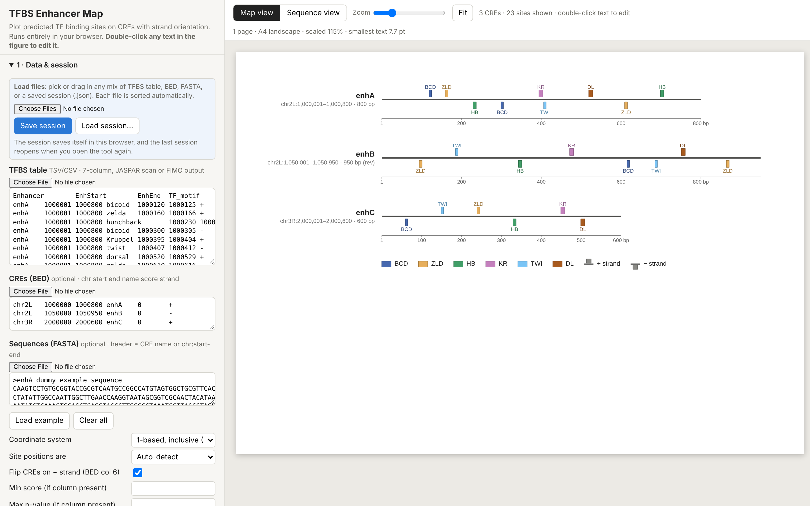
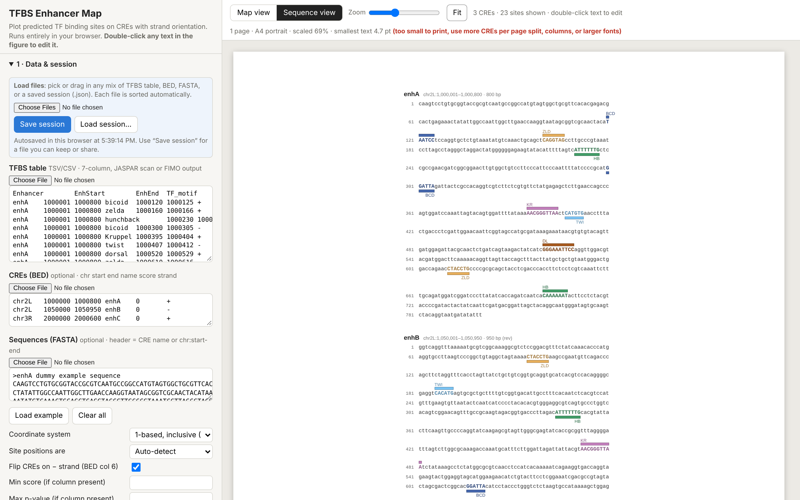

# TFBS Enhancer Map

A single-file, browser-based tool for drawing **publication-ready maps of predicted transcription-factor binding sites (TFBS) on cis-regulatory elements (CREs / enhancers)**. It keeps strand orientation (TRANSFAC Match-style) and visualizes the output of JASPAR, FIMO or any other TFBS scanner.

Everything runs locally in your browser. Nothing is uploaded, and no installation or internet connection is needed.



## Quick start

1. Download `index.html` (or clone the repository).
2. Open it in Chrome, Firefox, Edge or Safari.
3. Click **Load example** to see a dummy dataset. You can also drag your own files onto the page.

You can also host it with GitHub Pages: *Settings → Pages → Deploy from branch → `main` / root*. The tool will then be available at `https://<user>.github.io/<repo>/`.

## Input

You can provide any mix of the files below. Pick them or drag them in together, and each one is recognised automatically.

| Input | Required | Format |
|---|---|---|
| **TFBS table** | yes | TSV/CSV. Accepts the 7-column format below, JASPAR scan tables or FIMO TSV. Column names are detected automatically, and several tables are merged. |
| **CREs (BED)** | optional | `chr start end name score strand`. A CRE on the − strand is drawn reverse-complemented (optional). |
| **Sequences (FASTA)** | optional | Header = CRE name or `chr:start-end`. Needed for the sequence view. |
| **Session (.json)** | optional | A saved session that restores all data and settings. |

7-column TFBS format (no header needed):

```
Enhancer  EnhStart  EnhEnd   TF_motif  SiteStart  SiteEnd  Strand
enhA      1000001   1000800  bicoid    1000120    1000125  +
```

Site positions can be **genomic** (converted to CRE-relative automatically) or **relative to the CRE start**. Both 1-based inclusive (JASPAR/FIMO/TRANSFAC) and 0-based half-open (BED) coordinates are supported.

Example input files are in [`example/`](example/). They are **dummy data**: invented CREs with random sequence and illustrative consensus motifs planted at the listed sites.

## Features

**Views**
- **Map view.** CREs are drawn to scale, with + strand sites above the line and − strand sites below. Overlapping sites stack automatically.
- **Sequence view** (TRANSFAC Match-style). Site letters are coloured and uppercase, with bars above or below for each strand.

**Filtering & selection**
- Show/hide individual TFs and CREs, reorder CREs, and flip (reverse-complement) any CRE.
- **Shared-TF filter.** Show only TFs present in all shown CREs, or in at least *N* of them (either strand).
- Score / p-value filters when those columns are present.
- CRE length from coordinates, from the number in the CRE name (`enh1250` → 1250 bp), or typed per CRE.

**Names**
- Database tags are stripped automatically (`MA0535.1`, `_SANGER_10_FBgn…`, `_SOLEXA`, `_Cell`, …).
- An editable abbreviation list with ~200 common *Drosophila* TFs (`araucan` → `ara`, `Hormone receptor-like in 39` → `Hr39`, …).
- TF name style: ALL CAPS, first-letter capital (FlyBase protein style, e.g. `En`, `Bab`), or as given.
- Double-click any text in the figure to edit it. Find-and-replace works on all TF or CRE names.

**Styling**
- Fonts, sizes, colours, bold/italic for every text element.
- Line/box thickness for the backbone, sites, ruler and legend.
- Colorblind-safe palettes, including a soft 8-colour palette checked against deuteranopia, protanopia and tritanopia simulations. Also Okabe–Ito, Paul Tol muted and light, or your own palette.

**Export**
- **PDF** (vector, built in, works offline), **SVG** (vector, editable in Illustrator/Inkscape) and **PNG** (150/300/600 dpi).
- **Page setup:** A4, Letter, A5, A3 or Legal, with auto orientation, margins, fit-to-page, CRE columns and CREs per page. The toolbar shows the smallest printed text size.
- **Each CRE as a separate file** (ZIP of PDF/SVG/PNG).
- **Legend on its own** and a **TF table** (colour, TF, gene name, input motif name, + / − site counts, CREs containing the TF, per-CRE counts). The table comes as PDF/SVG/PNG or TSV.
- Site coordinates relative to each CRE (TSV).

**Sessions**
- Autosaves in the browser, and **Save / Load session** as a `.json` file containing all data and settings.



## Nomenclature note

For *Drosophila*, FlyBase writes **gene** symbols in italics (*en*, *bab*) and **protein** symbols upright with the first letter capitalized (En, Bab). ALL CAPS is the vertebrate protein convention. Choose the style your journal expects under *TF name style*.

## Notes

- PDF export uses the standard PDF fonts (Helvetica, Times, Courier), whichever is closest to the chosen font. For other fonts, export SVG and convert it in Illustrator/Inkscape.
- The built-in gene-name list is a convenience. Check names against [FlyBase](https://flybase.org) before publication, and edit the list as needed.
- Browser autosave stays in one browser on one computer. Use **Save session** to keep or share your work.

## License

MIT. See [LICENSE](LICENSE).
